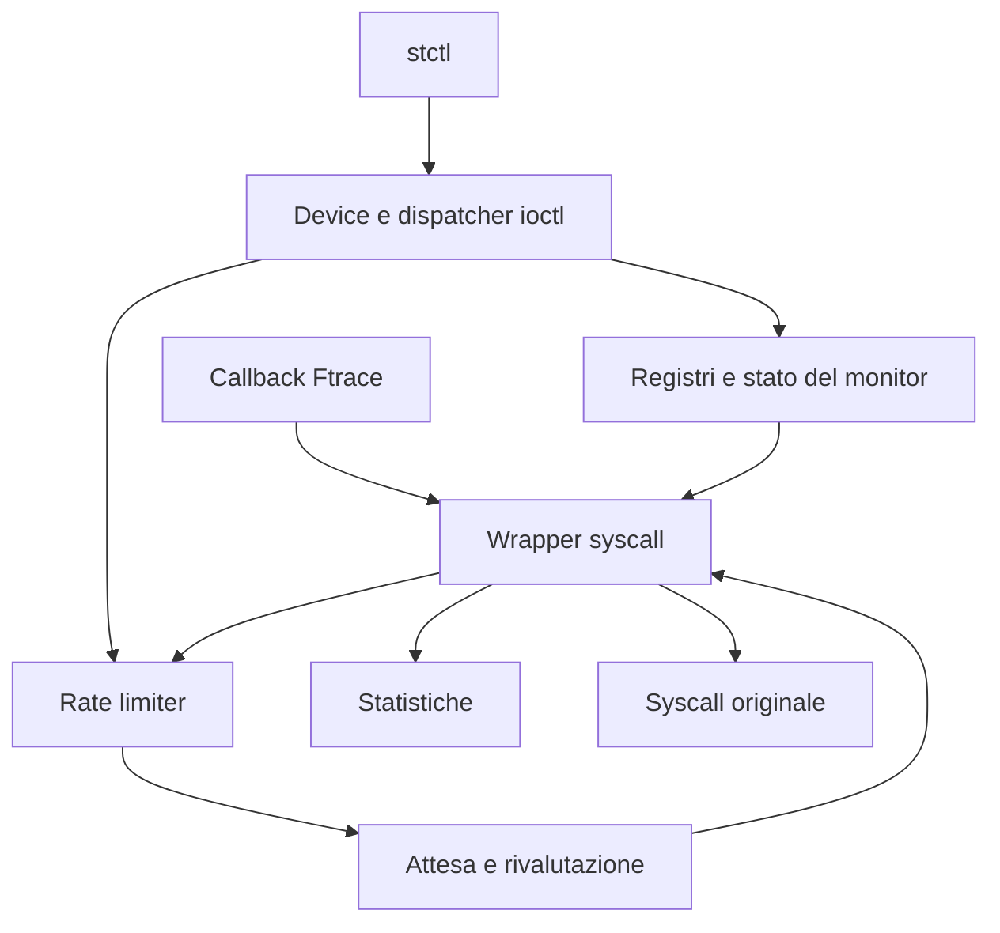

# Syscall Throttling — Linux Kernel Module

Progetto individuale di **Advanced Operating Systems**,
Università di Roma Tor Vergata, A.A. 2025–2026.

Il modulo `syscall_throttle` controlla le ammissioni alle syscall native x86-64.
Un amministratore registra nomi di eseguibili, effective UID e numeri di syscall,
poi configura un budget globale `MAX` per finestre di un secondo.
I thread oltre il limite attendono prima dell'esecuzione della syscall originale.

## Indice

- [Architettura e file](#architettura-e-file)
- [Flusso di una syscall](#flusso-di-una-syscall)
- [Strutture dati](#strutture-dati)
- [Budget, timer e transizioni](#budget-timer-e-transizioni)
- [Statistiche](#statistiche)
- [Concorrenza e ciclo di vita](#concorrenza-e-ciclo-di-vita)
- [Device, permessi e UAPI](#device-permessi-e-uapi)
- [Interfaccia user-space](#interfaccia-user-space)
- [Compilazione e demo](#compilazione-e-demo)
- [Verifiche della demo](#verifiche-della-demo)

## Architettura e file

| Percorso | Responsabilità |
|---|---|
| `module/main.c` | Inizializzazione, rollback e scaricamento |
| `module/device.c` | Miscdevice e riconoscimento delle ioctl di controllo |
| `module/device_ioctl.c` | Tabella di dispatch, permessi e transizioni amministrative |
| `module/monitor_state.c` | Stato ON/OFF tramite static key |
| `module/uid_registry.c` | Lista UID, lookup e snapshot |
| `module/program_registry.c` | Lista dei basename, validazione e snapshot |
| `module/program_identity.c` | Identità dell'eseguibile |
| `module/syscall_registry.c` | Bitmap dei numeri x86-64 e snapshot ordinato |
| `module/rate_limiter.c` | Budget, generazione, timer e attese |
| `module/statistics.c` | Statistiche di throttling |
| `module/syscall_hook.c` | Target, filtri Ftrace, wrapper e casi speciali |
| `module/*.h` | Interfacce interne dei componenti |
| `user/syscall_throttle.h` | Tipi e comandi condivisi tra kernel e user-space |
| `user/stctl.c` | Parsing, ioctl e visualizzazione |
| `demo/` | Tre script bash, supporto comune e worker C |

Le tre directory del progetto sono `module/`, `user/` e `demo/`.
L'header `user/syscall_throttle.h` definisce l'interfaccia condivisa: viene
incluso dal modulo e dall'interfaccia user-space; gli script della demo utilizzano l’interfaccia tramite user/stctl.



## Flusso di una syscall

L'intercettazione utilizza **Ftrace**, con risoluzione dei simboli tramite Kprobe.
Non modifica direttamente la syscall table. I target vengono derivati dagli header del kernel,
valida il nr_syscall ed elimina indirizzi duplicati condivisi tra più numeri.

1. La callback Ftrace applica le guardie previste e redirige al wrapper.
2. Il wrapper verifica numero e indirizzo originale e gestisce le eccezioni di
   controllo del device e il riferimento speciale di `delete_module`.
3. Se la policy non corrisponde, passa alla syscall originale.
4. Per una chiamata rilevante acquisisce il token della sessione statistica.
5. Nel ciclo acquisisce la generazione del limiter, rivaluta la policy e prova
   ad acquisire budget.
6. `RETRY` ripete la valutazione; `THROTTLE` registra la prima attesa e sospende
   il thread. Un risveglio richiede una nuova verifica: non assegna un posto.
7. `ALLOW`, `BYPASS` o `SHUTDOWN` concludono l'eventuale misura e consentono
   l'esecuzione originale. Un segnale interrompe invece l'attesa del limiter.
8. All'uscita vengono rilasciate le protezioni del wrapper; le syscall senza
   ritorno hanno un percorso dedicato.

I thread risvegliati competono nuovamente per il budget sotto lock.

## Strutture dati

### Registri e configurazione

| Tipo / contenitore | Contenuto e protezione |
|---|---|
| `st_uid_entry` | `kuid_t uid` e nodo di lista; rwsem del registro |
| `st_program_entry` | Nome fino a 255 byte più NUL e nodo di lista; rwsem |
| `st_syscall_bitmap` | Un bit per numero, dimensionato con `NR_syscalls` |
| Conteggi dei registri | Numero di elementi; aggiornati insieme al relativo registro |
| `st_monitor_enabled_key` | Static key del monitor |
| `st_ioctl_entry` | Comando, handler, privilegio richiesto e flag di notifica delle modifiche alla policy |

UID e programmi hanno helper `find_locked` comuni ad aggiunta, rimozione e
ricerca. Nel registro syscall gli aggiornamenti
usano `set_bit`/`clear_bit`; count e snapshot sono protetti da mutex, mentre il
matching usa `test_bit`. Le liste restituiscono snapshot, non viste permanenti.

### Limiter e statistiche

| Tipo | Contenuto e protezione |
|---|---|
| `st_rate_limiter_state` | Spinlock, timer, wait queue, limite `max_invocations`, ammissioni `admitted`, generazione e prossima scadenza. `running` indica l'attività; `stopping` distingue lo scaricamento definitivo da OFF |
| `st_statistics_state` | Generazioni di sessione/continuità, flag di attività e chiusura, timestamp, integrale temporale, waiter correnti e massimi, peak delay, EUID e programma del peak; spinlock dedicato e coda di drenaggio |
| `st_statistics_block_context` | Contesto sullo stack del wrapper: `generation`, `start_ns`, EUID, copia del nome e `counted`, che indica se l'attesa è stata contabilizzata e deve essere conclusa |
| `st_statistics_snapshot` | Durata, integrale, current/peak blocked, peak delay, EUID, nome e flag di validità/attività; nel layout corrente x86-64 occupa 304 byte |

Lo snapshot non espone contatori cumulativi di chiamate, media dei ritardi
individuali o numero della syscall del peak.

### Hook e interfaccia user-space

| Tipo | Ruolo |
|---|---|
| `st_syscall_definition` | Numero, simbolo e proprietà nonreturning della definizione |
| `st_hook_target` | Simbolo e indirizzo originale per numero, proprietà e provenienza |
| `st_hook_filter` | Indirizzo univoco e stato di installazione del filtro |
| `st_nonreturning_call` | Record del task per completare il lifetime di exit/exit_group |
| `registry_info` | Metadati per consultazione e stampa dei registri nella CLI |
| `command` | Tabella dei comandi della CLI |

`st_hook_active_calls`, la sua wait queue e i riferimenti al modulo proteggono
l'esecuzione durante lo scaricamento.

Le altre strutture UAPI trasportano stato, UID, nomi, numeri, conteggi, MAX e
richieste LIST con indirizzo user-space, capacità e conteggio restituito.
Si usano tipi a larghezza definita e indirizzi `__aligned_u64`; il kernel
inizializza le risposte prima di copiarle in user-space.

## Budget, timer e transizioni

La finestra è **fissa**, avviata da ENABLE e rinnovata tramite timer e `HZ`.
Non è un intervallo mobile né è allineata al calendario. La callback può subire
ritardi: non esiste una garanzia hard real-time o di deriva numerica prefissata.

| Operazione | Effetto sul budget | Effetto sulle statistiche |
|---|---|---|
| ENABLE da OFF | Nuova finestra, consumo zero | Nuova sessione |
| ENABLE già ON | Nessuna modifica | Nessuna modifica |
| MAX_SET identico | Consumo e scadenza invariati | Nessuna modifica |
| MAX_SET diverso, ON | Nuovo limite; consumo e scadenza conservati | Nuova sessione con waiter trasferiti |
| MAX_SET da OFF | Configura il prossimo avvio | Conserva lo snapshot |
| DISABLE | Ferma il limiter e risveglia i waiter | Drena le attese contabilizzate e congela |

Con tre posti già consumati, passare da MAX=3 a MAX=5 offre altri due posti.
Abbassare MAX sotto il consumo non revoca le ammissioni precedenti: impedisce
nuove ammissioni finché il budget torna disponibile.

**MAX=0 è valido:** sospende le chiamate rilevanti a monitor ON.
Una syscall originale già ammessa e bloccata non impedisce il rinnovo del budget.

## Statistiche

Il progetto calcola il numero medio di thread bloccati come media temporale:

```text
media thread bloccati = blocked_thread_time_ns / observation_ns
blocked_thread_time_ns = integrale nel tempo di current_blocked
```

Il picco dei thread bloccati è il massimo del conteggio corrente. Il peak delay
misura il ritardo dal primo THROTTLE fino alla conclusione dell'attesa, prima
della syscall originale: non include il tempo passato dentro quella syscall.
Programma ed EUID appartengono al campione selezionato per il peak.

Dopo un cambio effettivo di MAX a monitor ON, N waiter trasferiti danno
`current_blocked=N`, `peak_blocked=N`, integrale iniziale zero e peak delay non
ancora disponibile. Per quei waiter il ritardo è limitato all'inizio della nuova
sessione; non descrive necessariamente tutta l'attesa attraverso più sessioni.

Le attese interrotte contribuiscono al tempo integrato, ma non al peak delay.
`peak_valid` distingue un campione valido da nessun campione. Una chiamata ammessa
senza attesa può lasciare il peak non disponibile.

## Concorrenza e ciclo di vita

- Il mutex di policy serializza ENABLE, DISABLE e MAX_SET.
  Le aggiunte e rimozioni nei registri usano i rispettivi lock e,
  se riuscite, notificano il limiter per rivalutare i waiter.
- La generazione del limiter collega matching, acquisizione e attesa, evitando
  di addormentarsi su uno stato già superato.
- I timestamp contabili sono acquisiti sotto il lock delle statistiche.
  Quando entrambi servono, l'ordine è **limiter → statistiche**.
- L'integrale è aggiornato prima di modificare il numero dei thread bloccati.
  Risvegli e attese non vengono eseguiti mantenendo il lock delle statistiche.
- `timer_delete_sync` consente lo stop riavviabile; `timer_shutdown_sync`
  gestisce la chiusura definitiva. Non sono intercambiabili.

All'inizializzazione vengono preparati registri, limiter e statistiche, poi hook
e device. I percorsi di errore rilasciano i componenti già inizializzati.
Allo scaricamento si rimuove il device, si arresta definitivamente il limiter,
si smonta l'hook attendendo le chiamate attive, quindi si rilasciano statistiche,
registri e stato del monitor.

DISABLE attende la contabilizzazione delle attese rilasciate, **non** il ritorno
delle syscall originali. Al contrario lo scaricamento può attendere una syscall
originale ancora attiva, per esempio una read su pipe vuota.

Le attese usano `wait_event_interruptible`: il task può attendere senza
occupare la CPU ed essere risvegliato quando cambia lo stato del limiter.
In questo caso ripete i controlli sulla policy e sul budget.

Un segnale può invece interrompere l'attesa. Il wrapper restituisce allora
`-ERESTARTSYS` senza eseguire la syscall originale. Questo codice è interno
al kernel: dal lato user-space la chiamata può essere riavviata automaticamente
oppure terminare con errore `EINTR`, a seconda della gestione del segnale,
della syscall e dell'eventuale flag `SA_RESTART`.

`exit` e `exit_group` usano record associati al task e il tracepoint
`sched_process_exit` per rilasciare la protezione quando il wrapper non ritorna.

Quando delete_module entra nel wrapper, viene acquisito un riferimento al
modulo anche se programma ed EUID non sono registrati. L'intercettazione
richiede comunque monitor ON e numero di syscall registrato.

Se il riferimento non può essere acquisito, il wrapper restituisce EBUSY.
Nel percorso intercettato O_TRUNC viene rifiutato con EPERM, dopo l'eventuale
attesa del limiter, indipendentemente dal modulo indicato nella richiesta.

## Device, permessi e UAPI

Il miscdevice è `/dev/syscall_throttle`, con permessi 0666. Le consultazioni sono
pubbliche; gli aggiornamenti richiedono EUID uguale a `GLOBAL_ROOT_UID` nel
namespace iniziale. Essere root soltanto in un user namespace non è sufficiente.

Le ioctl riconosciute dirette al vero oggetto file del device bypassano il
limiter, mantenendo controlli LSM e permessi del dispatcher. Il driver mantiene
un riferimento al file durante l'operazione, così continua a usare lo stesso
oggetto anche se un altro thread chiude o sostituisce il descrittore.
Comandi sconosciuti o comandi noti su altri file non ricevono questa eccezione.

Non esiste esenzione generale per root o per `stctl`. Il bypass non copre avvio
del programma, librerie o apertura del device: una configurazione può bloccare
una syscall precedente al comando amministrativo.

## Interfaccia user-space

I comandi si eseguono come `./user/stctl <comando>`.

| Comando CLI | Ioctl (`ST_IOCTL_` + suffisso) | Root |
|---|---|---|
| `enable` / `disable` | ENABLE / DISABLE | Sì |
| `max-set <valore>` / `max-get` | MAX_SET / MAX_GET | Solo SET |
| `uid-add <UID>` / `uid-remove <UID>` | UID_ADD / UID_REMOVE | Sì |
| `uid-count` / `uid-list` | UID_GET_COUNT / UID_LIST | No |
| `program-add <nome>` / `program-remove <nome>` | PROGRAM_ADD / PROGRAM_REMOVE | Sì |
| `program-count` / `program-list` | PROGRAM_GET_COUNT / PROGRAM_LIST | No |
| `syscall-add <numero>` / `syscall-remove <numero>` | SYSCALL_ADD / SYSCALL_REMOVE | Sì |
| `syscall-count` / `syscall-list` | SYSCALL_GET_COUNT / SYSCALL_LIST | No |
| `stats` | STATS_GET | No |

Nomi: basename non vuoto, senza slash e lungo al massimo 255 byte. Numeri syscall:
intervallo derivato da `NR_syscalls` degli header di compilazione. L'aggiunta di un
elemento presente restituisce EEXIST; la rimozione di un elemento assente ENOENT.

## Compilazione e demo

Ambiente utilizzato:
- Distribuzione: Ubuntu 24.04.3 LTS.
- Kernel: `7.0.0-38-generic`.

Richiesti Linux x86-64 nativo, compilatore C, make e header compatibili
con il kernel in esecuzione. Il modulo utilizza Kprobes, Ftrace con
salvataggio dei registri e modifica dell'instruction pointer, e il
tracepoint sched_process_exit.

Per eseguire la demo servono Bash, sudo, gli strumenti insmod/rmmod,
timeout, awk e le comuni utility di sistema, con /sys montato.
Eseguire i comandi come utente normale, senza sudo davanti a make.

| Comando | Operazione |
|---|---|
| `make` oppure `make load` | Compila modulo e user, poi carica il modulo se assente |
| `make build` | Compila soltanto modulo e user |
| `make unload` | Compila  user se necessario, disattiva il monitor e scarica il modulo, conservando i file compilati | modulo?)
| `make demo` | Compila modulo, interfaccia user-space e worker; esegue tre fasi, ciascuna con caricamento iniziale e scaricamento finale del modulo in caso di successo |
| `make clean` | Elimina gli artefatti di compilazione delle tre cartelle, senza scaricare il modulo |

Per l'uso manuale:

```bash
make
sudo ./user/stctl max-set 5
./user/stctl max-get
```

Un nuovo caricamento lascia il monitor OFF, i registri vuoti e MAX=0 ed impostare MAX non attiva il monitor. Se il modulo è già caricato,
`make` conserva la configurazione e il codice in memoria: per caricare il codice
ricompilato usare `make unload` seguito da `make`.

Per la demo, con modulo inizialmente scaricato e senza altre prove in parallelo:

```bash
make demo
```

Dalla radice, `make -C demo` compila ed esegue le tre fasi.
`make -C demo build` compila modulo, user e i due eseguibili
demo_worker e demo_alt senza avviare le prove.

## Verifiche della demo

La demo combina osservazione dei tempi e delle statistiche con alcuni
controlli automatici, tra cui il rifiuto di una modifica non privilegiata
e lo stato 42 per exit ed exit_group.

Il messaggio finale indica il completamento delle tre fasi e dei controlli
presenti; non certifica tutte le proprietà del modulo. In particolare,
i tempi e gli errno delle prove delete_module vengono mostrati ma non
confrontati automaticamente con i risultati attesi.

| Script | Operazioni mostrate |
|---|---|
| `demo/fase1.sh` | Registri, letture non privilegiate, modifica rifiutata senza root, selezione per programma e per EUID, bypass OFF e syscall non registrata. |
| `demo/fase2.sh` | Budget condiviso fra processi e syscall; statistiche durante le attese con MAX=0 e rilascio tramite OFF. |
| `demo/fase3.sh` | Due read su pipe con OFF/ON, exit ed exit_group con stato 42, richieste delete_module con visualizzazione dei rifiuti attesi e scaricamento ordinario. |

Per eseguire una sola fase, dopo `make -C demo build`, usare ad esempio
`bash demo/fase2.sh`. Ogni fase carica un modulo nuovo e lo scarica alla fine.
Il supporto comune in `demo/common.sh` gestisce cleanup e timeout.

`demo/worker.c` genera `demo_worker` e `demo_alt`, due basename distinti per
mostrare la selezione per eseguibile. Mostra i tempi delle chiamate e gli esiti delle prove;
la prova pipe usa due piccoli file temporanei per partire dopo l'attivazione del
monitor, evitando che le read del loader consumino il budget. I file vengono
rimossi al termine.

Le syscall exit ed exit_group sono eseguite in processi monothread: 42 e' lo stato
di terminazione scelto dal programma, non un ritorno della syscall.
Le prove di delete_module richiedono la rimozione di syscall_throttle
con privilegi root, monitor ON, MAX=1 e syscall registrata.
Il programma registrato passa dal limiter; quello non registrato lo bypassa.

Prima della richiesta, l'interfaccia user-space ha chiuso il device.
L'hook mantiene comunque un riferimento temporaneo al modulo durante
la chiamata: con O_NONBLOCK, il kernel rifiuta quindi la rimozione
con EWOULDBLOCK perché il modulo è ancora in uso.

Aggiungendo O_TRUNC si richiede la rimozione forzata, che viene invece
rifiutata direttamente dall'hook con EPERM. Entrambi i casi vengono
mostrati sia con programma registrato sia con programma non registrato.
