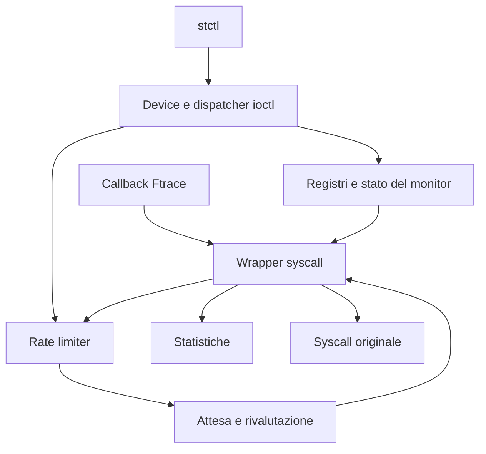

# Syscall Throttling — Linux Kernel Module

Progetto individuale di **Advanced Operating Systems (and System Security)**,
Università di Roma Tor Vergata, A.A. 2025–2026.

Il modulo `syscall_throttle` controlla le ammissioni alle syscall native x86-64.
Un amministratore registra nomi di eseguibili, effective UID e numeri di syscall,
poi configura un budget globale `MAX` per finestre di un secondo.
I thread oltre il limite attendono prima dell'esecuzione della syscall originale.

## Indice

- [Requisiti e comportamento](#requisiti-e-comportamento)
- [Architettura e file](#architettura-e-file)
- [Flusso di una syscall](#flusso-di-una-syscall)
- [Strutture dati](#strutture-dati)
- [Budget, timer e transizioni](#budget-timer-e-transizioni)
- [Statistiche](#statistiche)
- [Concorrenza e ciclo di vita](#concorrenza-e-ciclo-di-vita)
- [Device, permessi e UAPI](#device-permessi-e-uapi)
- [Controller](#controller)
- [Compilazione e demo](#compilazione-e-demo)
- [Verifiche della demo](#verifiche-della-demo)

## Requisiti e comportamento

La condizione di selezione è:

```text
monitor ON AND syscall registrata AND (programma registrato OR EUID registrato)
```

Il budget è condiviso tra tutti i programmi, UID e numeri selezionati: non esiste
un budget indipendente per ogni registro o processo. Si limitano le **ammissioni**,
non il numero delle syscall contemporaneamente in esecuzione.

| Requisito della traccia | Realizzazione |
|---|---|
| Registrare/rimuovere programmi, UID e syscall | Registri gestiti tramite ioctl |
| Selezionare programma oppure effective UID | Matching OR con numero di syscall registrato |
| Limitare le invocazioni a MAX per secondo | Budget globale e timer a finestre fisse |
| Sospendere i thread oltre il limite | Wait queue interruptible nel wrapper |
| Gestire syscall bloccanti e non bloccanti | Attesa del limiter separata dalla syscall originale |
| Consultare i registri | Comandi COUNT e LIST |
| Riservare le modifiche a root | Controllo EUID nel driver |
| Attivare/disattivare il monitor | ENABLE e DISABLE |
| Peak delay, programma e UID associati | Snapshot statistico |
| Numero medio e massimo di thread bloccati | Integrale temporale e picco |
| Controller e test user-space | `user/` e `demo/` |

Il nome selezionato è il **basename dell'eseguibile**, ricavato da `mm->exe_file`.
Non è `argv[0]` né il nome modificabile del thread. Per i programmi interpretati
conta l'eseguibile dell'interprete. Nomi uguali in directory diverse corrispondono
allo stesso criterio; il basename non costituisce una barriera di sicurezza.

## Architettura e file

| Percorso | Responsabilità |
|---|---|
| `module/main.c` | Inizializzazione, rollback e scaricamento |
| `module/device.c` | Miscdevice e riconoscimento delle ioctl di controllo |
| `module/device_ioctl.c` | Tabella di dispatch, permessi e transizioni amministrative |
| `module/monitor_state.c` | Stato ON/OFF tramite static key |
| `module/uid_registry.c` | Lista UID, lookup e snapshot |
| `module/program_registry.c` | Lista dei basename, validazione e snapshot |
| `module/program_identity.c` | Identità dell'eseguibile con riferimenti stabili |
| `module/syscall_registry.c` | Bitmap dei numeri x86-64 e snapshot ordinato |
| `module/rate_limiter.c` | Budget, generazione, timer e attese |
| `module/statistics.c` | Sessioni, integrale dei waiter e peak delay |
| `module/syscall_hook.c` | Target, filtri Ftrace, wrapper e casi speciali |
| `module/*.h` | Interfacce interne dei componenti |
| `user/syscall_throttle.h` | Tipi e comandi condivisi tra kernel e user-space |
| `user/stctl.c` | Parsing, ioctl e visualizzazione |
| `demo/` | Demo automatica C: controller, worker, protocollo e Makefile |

Il Makefile nella radice coordina quelli di `module/`, `user/` e `demo/`.
Le tre directory del progetto sono `module/`, `user/` e `demo/`.
L'header `user/syscall_throttle.h` definisce l'interfaccia condivisa: viene
incluso dal modulo, dal controller e dalla demo.



## Flusso di una syscall

L'intercettazione utilizza **Ftrace**, con risoluzione dei simboli tramite Kprobe.
Non modifica direttamente la syscall table e non richiede un modulo esterno per
scoprirne l'indirizzo. La preparazione deriva i target dagli header del kernel,
controlla le definizioni e deduplica gli indirizzi condivisi da più numeri.

1. La callback Ftrace applica le guardie previste e redirige al wrapper.
2. Il wrapper verifica numero e indirizzo originale e gestisce le eccezioni di
   controllo del device e il riferimento speciale di `delete_module`.
3. Se la policy non corrisponde, passa alla syscall originale.
4. Per una chiamata rilevante acquisisce il token della sessione statistica.
5. Nel ciclo acquisisce la generazione del limiter, rivaluta la policy e prova
   ad acquisire budget.
6. `RETRY` ripete la valutazione; `THROTTLE` registra la prima attesa e sospende
   il thread. Un risveglio richiede una nuova verifica: non assegna un posto.
7. `ALLOW`, `BYPASS` o `SHUTDOWN` concludono l'eventuale misura e consentono
   l'esecuzione originale. Un segnale interrompe invece l'attesa del limiter.
8. All'uscita vengono rilasciate le protezioni del wrapper; le syscall senza
   ritorno hanno un percorso dedicato.

I thread risvegliati competono nuovamente per il budget sotto lock. Non è
implementata una politica FIFO né una garanzia di ordine fra i waiter.

## Strutture dati

### Registri e configurazione

| Tipo / contenitore | Contenuto e protezione |
|---|---|
| `st_uid_entry` | `kuid_t uid` e nodo di lista; rwsem del registro |
| `st_program_entry` | Nome fino a 255 byte più NUL e nodo di lista; rwsem |
| `st_syscall_bitmap` | Un bit per numero, dimensionato con `NR_syscalls` |
| Conteggi dei registri | Numero di elementi; aggiornati insieme al relativo registro |
| `st_monitor_enabled_key` | Static key del monitor |
| `st_ioctl_entry` | Comando, handler, privilegio richiesto e serializzazione della policy |

UID e programmi hanno helper `find_locked` comuni ad aggiunta, rimozione e
ricerca. Il chiamante mantiene il lock. Nel registro syscall gli aggiornamenti
usano `set_bit`/`clear_bit`; count e snapshot sono protetti da mutex, mentre il
matching usa `test_bit`. Le liste restituiscono snapshot, non viste permanenti.

### Limiter e statistiche

`st_rate_limiter_state` contiene spinlock, timer, wait queue, `max_invocations`,
`admitted`, `generation`, `next_expiry`, `running` e `stopping`.
`running` indica l'attività; `stopping` distingue lo scaricamento definitivo da OFF.

`st_statistics_state` conserva generazioni di sessione/continuità, flag di attività
e chiusura, timestamp, integrale temporale, waiter correnti e massimi, peak delay,
EUID e programma del peak. Il suo spinlock e la coda di drenaggio sono separati.

`st_statistics_block_context`, sullo stack del wrapper, conserva `generation`,
`start_ns`, EUID, copia del nome e `counted`. Quest'ultimo indica se l'attesa è
stata contabilizzata e deve essere conclusa.

`st_statistics_snapshot` espone durata, integrale, current/peak blocked, peak
delay, EUID, nome e flag di validità/attività. Nel layout corrente x86-64 occupa
304 byte. Non espone contatori cumulativi di chiamate, media dei ritardi
individuali o numero della syscall del peak.

### Hook e controller

| Tipo | Ruolo |
|---|---|
| `st_syscall_definition` | Numero, simbolo e proprietà nonreturning della definizione |
| `st_hook_target` | Simbolo e indirizzo originale per numero, proprietà e provenienza |
| `st_hook_filter` | Indirizzo univoco e stato di installazione del filtro |
| `st_nonreturning_call` | Record del task per completare il lifetime di exit/exit_group |
| `registry_info` | Metadati per consultazione e stampa dei registri nella CLI |
| `command` | Tabella dei comandi della CLI |
| `worker` (demo) | PID, descriptor e risultato dei processi di prova |
| `demo_result` (demo) | Messaggi READY/RESULT, esito e tempi della syscall |

`st_hook_active_calls`, la sua wait queue e i riferimenti al modulo proteggono
l'esecuzione durante lo scaricamento. I tre contatori diagnostici nonreturning
registrano l'attività delle syscall senza ritorno e non fanno parte dello snapshot UAPI.

Le altre strutture UAPI trasportano stato, UID, nomi, numeri, conteggi, MAX e
richieste LIST con indirizzo user-space, capacità e conteggio restituito.
Si usano tipi a larghezza definita e indirizzi `__aligned_u64`; il kernel
inizializza le risposte prima di copiarle in user-space.

## Budget, timer e transizioni

La finestra è **fissa**, avviata da ENABLE e rinnovata tramite timer e `HZ`.
Non è un intervallo mobile né è allineata al calendario. La callback può subire
ritardi: non esiste una garanzia hard real-time o di deriva numerica prefissata.

| Operazione | Effetto sul budget | Effetto sulle statistiche |
|---|---|---|
| ENABLE da OFF | Nuova finestra, consumo zero | Nuova sessione |
| ENABLE già ON | Nessuna modifica | Nessuna modifica |
| MAX_SET identico | Consumo e scadenza invariati | Nessuna modifica |
| MAX_SET diverso, ON | Nuovo limite; consumo e scadenza conservati | Nuova sessione con waiter trasferiti |
| MAX_SET da OFF | Configura il prossimo avvio | Conserva lo snapshot |
| DISABLE | Ferma il limiter e risveglia i waiter | Drena le attese contabilizzate e congela |

Con tre posti già consumati, passare da MAX=3 a MAX=5 offre altri due posti.
Abbassare MAX sotto il consumo non revoca le ammissioni precedenti: impedisce
nuove ammissioni finché il budget torna disponibile.

**MAX=0 è valido:** sospende le chiamate rilevanti a monitor ON. Non equivale a OFF.
Una syscall originale già ammessa e bloccata non impedisce il rinnovo del budget.

## Statistiche

La media richiesta è una media temporale:

```text
media thread bloccati = blocked_thread_time_ns / observation_ns
blocked_thread_time_ns = integrale nel tempo di current_blocked
```

Il picco dei thread bloccati è il massimo del conteggio corrente. Il peak delay
misura il ritardo dal primo THROTTLE fino alla conclusione dell'attesa, prima
della syscall originale: non include il tempo passato dentro quella syscall.
Programma ed EUID appartengono al campione selezionato per il peak.

Dopo un cambio effettivo di MAX a monitor ON, N waiter trasferiti danno
`current_blocked=N`, `peak_blocked=N`, integrale iniziale zero e peak delay non
ancora disponibile. Per quei waiter il ritardo è limitato all'inizio della nuova
sessione; non descrive necessariamente tutta l'attesa attraverso più sessioni.

Le attese interrotte contribuiscono al tempo integrato, ma non al peak delay.
`peak_valid` distingue un campione valido da nessun campione. Una chiamata ammessa
senza attesa può lasciare il peak non disponibile. Non esiste reset manuale.

## Concorrenza e ciclo di vita

- Il mutex di policy serializza le transizioni amministrative; i registri hanno
  lock propri. Le modifiche notificano il limiter per rivalutare i waiter.
- La generazione del limiter collega matching, acquisizione e attesa, evitando
  di addormentarsi su uno stato già superato.
- I timestamp contabili sono acquisiti sotto il lock delle statistiche.
  Quando entrambi servono, l'ordine è **limiter → statistiche**.
- L'integrale è aggiornato prima di modificare il numero dei thread bloccati.
  Risvegli e attese non vengono eseguiti mantenendo il lock delle statistiche.
- `timer_delete_sync` consente lo stop riavviabile; `timer_shutdown_sync`
  gestisce la chiusura definitiva. Non sono intercambiabili.

All'inizializzazione vengono preparati registri, limiter e statistiche, poi hook
e device. I percorsi di errore rilasciano i componenti già inizializzati.
Allo scaricamento si rimuove il device, si arresta definitivamente il limiter,
si smonta l'hook attendendo le chiamate attive, quindi si rilasciano statistiche,
registri e stato del monitor.

DISABLE attende la contabilizzazione delle attese rilasciate, **non** il ritorno
delle syscall originali. Al contrario lo scaricamento può attendere una syscall
originale ancora attiva, per esempio una read su pipe vuota.

Le attese usano `wait_event_interruptible`. Il percorso restituisce il codice
interno di riavvio previsto; il risultato user-space dipende da syscall, segnale
e `SA_RESTART`.

`exit` e `exit_group` usano record associati al task e il tracepoint
`sched_process_exit` per rilasciare la protezione quando il wrapper non ritorna.

`delete_module` acquisisce un riferimento al monitor anche fuori dal matching.
L'autorimozione ordinaria intercettata viene normalmente rifiutata con
EWOULDBLOCK; se il riferimento non può essere acquisito il wrapper restituisce
EBUSY. `O_TRUNC` è rifiutato con EPERM nel percorso intercettato, anche fuori
policy: è una restrizione esplicita rispetto alla syscall originale.

## Device, permessi e UAPI

Il miscdevice è `/dev/syscall_throttle`, con modo 0666. Le consultazioni sono
pubbliche; gli aggiornamenti richiedono EUID uguale a `GLOBAL_ROOT_UID` nel
namespace iniziale. Essere root soltanto in un user namespace non è sufficiente.

Le ioctl riconosciute dirette al vero oggetto file del device bypassano il
limiter, mantenendo controlli LSM e permessi del dispatcher. Un riferimento al
file preserva l'oggetto anche con close/dup2 concorrenti. Comandi sconosciuti o
comandi noti su altri file non ricevono questa eccezione.

Non esiste esenzione generale per root o per `stctl`. Il bypass non copre avvio
del programma, librerie o apertura del device: una configurazione può bloccare
una syscall precedente al comando amministrativo.

L'UAPI corrente contiene **18 comandi**. Le LIST comunicano la dimensione
necessaria con ENOSPC e non consegnano snapshot parziali per capacità insufficiente.
La CLI limita i retry in caso di crescita concorrente. I percorsi per liste
inizialmente vuote differiscono ancora tra registri; non si presume un unico
istante di osservazione fra COUNT e LIST.

I numeri ioctl 0x00, 0x50 e 0x51 sono ritirati. STATS_GET usa 0x52; il codice
completo include la dimensione della struttura. Ricompilare modulo, controller
e demo dalla stessa versione dopo modifiche dell'UAPI.

## Controller

I comandi si eseguono come `./user/stctl <comando>`.

| Comando CLI | Ioctl (`ST_IOCTL_` + suffisso) | Root |
|---|---|---|
| `status` | GET_STATUS | No |
| `enable` / `disable` | ENABLE / DISABLE | Sì |
| `max-set <valore>` / `max-get` | MAX_SET / MAX_GET | Solo SET |
| `uid-add <UID>` / `uid-remove <UID>` | UID_ADD / UID_REMOVE | Sì |
| `uid-count` / `uid-list` | UID_GET_COUNT / UID_LIST | No |
| `program-add <nome>` / `program-remove <nome>` | PROGRAM_ADD / PROGRAM_REMOVE | Sì |
| `program-count` / `program-list` | PROGRAM_GET_COUNT / PROGRAM_LIST | No |
| `syscall-add <numero>` / `syscall-remove <numero>` | SYSCALL_ADD / SYSCALL_REMOVE | Sì |
| `syscall-count` / `syscall-list` | SYSCALL_GET_COUNT / SYSCALL_LIST | No |
| `stats` | STATS_GET | No |

Nomi: basename non vuoto, senza slash e lungo al massimo 255 byte. Numeri syscall:
intervallo derivato da `NR_syscalls` degli header di compilazione. L'aggiunta di un
elemento presente restituisce EEXIST; la rimozione di un elemento assente ENOENT.
Validazioni e privilegi sono controllati anche dal driver, indipendentemente
dalla CLI. Non sono disponibili comandi `ping`, `stats-reset` o selezione FIFO.

## Compilazione e demo

Richiesti Linux x86-64 nativo, compilatore C, make, header del kernel in esecuzione,
`sudo` e `/proc`. Eseguire i comandi dalla radice del repository come utente
normale, senza `sudo` davanti a `make`.

| Comando | Operazione |
|---|---|
| `make` oppure `make load` | Compila modulo e controller, poi carica il modulo se assente |
| `make build` | Compila soltanto modulo e controller |
| `make unload` | Compila il controller se necessario, disattiva il monitor e scarica il modulo |
| `make demo` | Compila tutto, carica il modulo, esegue la demo e lo scarica dopo il successo |
| `make clean` | Elimina gli artefatti di compilazione delle tre cartelle, senza scaricare il modulo |

Per l'uso manuale:

```bash
make
sudo ./user/stctl max-set 5
./user/stctl max-get
```

Un nuovo caricamento lascia il monitor OFF, pronto per registrazioni e
configurazione. Impostare MAX non attiva il monitor. Se il modulo è già caricato,
`make` conserva la configurazione e il codice in memoria: per caricare il codice
ricompilato usare `make unload` seguito da `make`.

Per la demo, con modulo inizialmente scaricato e senza altre prove in parallelo:

```bash
make demo
```

Si può anche entrare in `demo/` ed eseguire `make`. In quella cartella,
`make build` compila modulo, controller e demo senza eseguirli; `make clean`
elimina solo i tre eseguibili della demo.

Le operazioni privilegiate richiedono la password `sudo` se necessaria. Non
vengono creati file di log. La demo rifiuta di partire se il modulo è già caricato;
in caso di errore lascia il modulo caricato per consentire l'ispezione.

La demo richiede monitor OFF, MAX=0 e registri vuoti. Usa direttamente le ioctl;
`user/stctl` è il controller per l'uso manuale. Il Makefile genera `soa_demo` e
i due eseguibili `demo_worker` e `demo_alt` dallo stesso sorgente `worker.c`.
I worker vengono avviati automaticamente dalla demo.

`PASS` indica il superamento di una verifica; `DEMO SUPERATA` conferma tutte le
sei fasi, con monitor OFF, MAX=0 e registri vuoti. `FAIL` indica un errore;
`INCONCLUSIVO` indica che l'osservazione non è sufficiente per concludere.
Un timeout non è un esito positivo. La sequenza scarica il modulo solo dopo
il successo della demo.

La fase 3 stampa anche programma, EUID, syscall, istante di completamento e
durata di ogni worker, in ordine di completamento. L'origine dei tempi precede
ENABLE; le durate user-space comprendono anche overhead e scheduling. MAX=0
significa blocco di tutte le chiamate selezionate in questa implementazione ed
è usato per osservare matching e rilascio in modo controllato.

La fase 6 prova `exit` e `exit_group` in figli monothread: prima ne osserva il
blocco con MAX=0, poi le ammette e verifica l'uscita con stato 42, senza messaggio
di ritorno. Non è una prova di terminazione di un gruppo multithread.
Prova inoltre l'autorimozione con `delete_module(O_NONBLOCK)`, sia con programma
selezionato sia fuori matching, aspettandosi EWOULDBLOCK. Prima chiude il device
e verifica `refcnt=0`: così il riferimento del device non maschera quello del
wrapper. Non devono esserci controller o altre prove aperti in parallelo.
Il caso `O_TRUNC` usa esclusivamente un nome di modulo inesistente, verificato
anche dal worker, e deve ricevere EPERM con monitor ON e syscall registrata.
Non viene mai richiesta la rimozione forzata del monitor o di altri moduli reali.

Dopo le sei fasi, OFF e chiusura del device, il target `run` di `demo/Makefile` verifica lo
scaricamento ordinario con timeout e l'assenza del modulo in `/sys/module`.
Legge quindi la diagnostica nonreturning da `dmesg`, dopo il nuovo messaggio di
caricamento, e stampa il messaggio reale e il confronto con i valori attesi:
`avviate=2, completate=2, ritorni_inattesi=0`. Un vecchio log non basta.
Il messaggio finale `DEMO SUPERATA` compare soltanto dopo questo confronto.
Se il log manca o non è leggibile, l'esito è inconclusivo; se i contatori sono
diversi da quelli attesi, è FAIL. Non eseguire altre prove o caricamenti del
modulo in parallelo. Il log viene letto senza cancellarlo.

Ogni fase mostra anche le osservazioni su cui si basano i controlli:

- Fase 1: errno osservati/attesi, conteggi dei registri e operazioni non-root.
- Fase 2: attesa individuale in `wchan`, waiter e risultato dopo il rilascio.
- Fase 3: completamenti, waiter e intervallo dei campioni nella prima finestra.
- Fase 4: incremento dell'integrale confrontato con quattro volte il tempo,
  oltre al confronto degli snapshot con monitor OFF.
- Fase 5: attesa della read sulla pipe, completamento di getpid e confronto
  delle statistiche prima e dopo il completamento della read a monitor OFF.
- Fase 6: stato di uscita, EOF, riferimenti iniziali, errno e stato del monitor;
  dopo lo scaricamento, contatori effettivi dal kernel.

Se `/proc/PID/wchan` o il contatore dei riferimenti non sono osservabili, oppure
i tempi della VM non permettono la misura, l'esito è INCONCLUSIVO, non PASS.

## Verifiche della demo

Ogni riga descrive una singola fase. Le funzioni che conducono le prove sono in
[`demo/demo.c`](demo/demo.c); l'ultima colonna indica le principali funzioni del
modulo coinvolte nelle verifiche.

| Fase | Funzione della demo e comportamento verificato | Funzioni principali del modulo e file |
|---|---|---|
| 1. Registri e privilegi | `registry_demo()`: aggiunta, consultazione, rimozione e permessi | [`module/device_ioctl.c`](module/device_ioctl.c): `st_device_ioctl_dispatch()`, `st_ioctl_uid_update()`, `st_ioctl_program_update()`, `st_ioctl_syscall_update()` |
| 2. Selezione e OFF | `matching_demo()`: selezione per programma oppure EUID, deregistrazione e bypass OFF | [`module/syscall_hook.c`](module/syscall_hook.c): `st_syscall_is_relevant()`, `st_syscall_policy_still_matches()`; [`module/device_ioctl.c`](module/device_ioctl.c): `st_ioctl_enable()`, `st_ioctl_disable()` |
| 3. Budget globale | `budget_demo()`: limite condiviso, sospensione e rinnovo del budget | [`module/rate_limiter.c`](module/rate_limiter.c): `st_rate_limiter_try_acquire()`, `st_rate_limiter_wait_for_change()`, `st_rate_limiter_timer_callback()` |
| 4. Statistiche | `statistics_demo()`: media temporale, picchi, identità del peak e snapshot OFF | [`module/statistics.c`](module/statistics.c): `st_statistics_account_blocked_time_locked()`, `st_statistics_block_finish()`, `st_statistics_get_snapshot()` |
| 5. Syscall bloccante | `blocking_demo()`: read su pipe, rinnovo del budget e DISABLE con syscall originale ancora attiva | [`module/syscall_hook.c`](module/syscall_hook.c): `st_generic_syscall_wrapper()`; [`module/device_ioctl.c`](module/device_ioctl.c): `st_ioctl_disable()` |
| 6. Nonreturning e delete_module | `special_calls_demo()`: exit/exit_group, autorimozione rifiutata, O_TRUNC su target inesistente; poi unload dal Makefile | [`module/syscall_hook.c`](module/syscall_hook.c): `st_nonreturning_call_track()`, `st_sched_process_exit_callback()`, `st_call_original_syscall()`, `st_generic_syscall_wrapper()`, `st_syscall_hook_exit()` |
