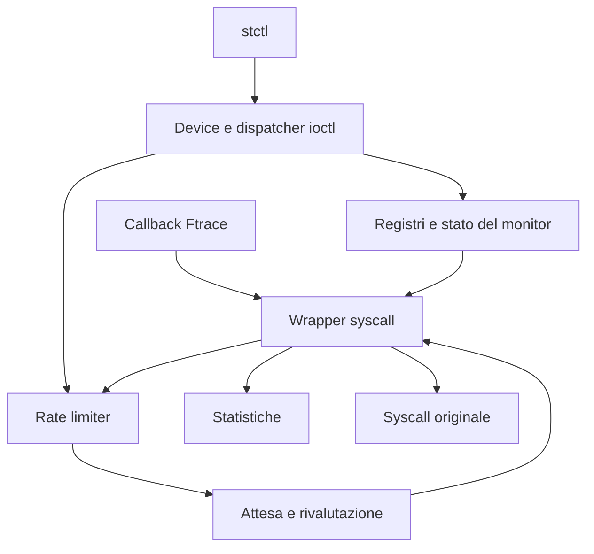

# Syscall Throttling — Linux Kernel Module

Progetto individuale di **Advanced Operating Systems (and System Security)**,
Università di Roma Tor Vergata, A.A. 2025–2026.

Il modulo `syscall_throttle` controlla le ammissioni alle syscall native x86-64.
Un amministratore registra nomi di eseguibili, effective UID e numeri di syscall,
poi configura un budget globale `MAX` per finestre di un secondo.
I thread oltre il limite attendono prima dell'esecuzione della syscall originale.

## Indice

- [Requisiti e comportamento](#requisiti-e-comportamento)
- [Architettura e file](#architettura-e-file)
- [Flusso di una syscall](#flusso-di-una-syscall)
- [Strutture dati](#strutture-dati)
- [Budget, timer e transizioni](#budget-timer-e-transizioni)
- [Statistiche](#statistiche)
- [Concorrenza e ciclo di vita](#concorrenza-e-ciclo-di-vita)
- [Device, permessi e UAPI](#device-permessi-e-uapi)
- [Controller](#controller)
- [Compilazione e demo](#compilazione-e-demo)
- [Test](#test)
- [Ambiente verificato e limiti](#ambiente-verificato-e-limiti)

## Requisiti e comportamento

La condizione di selezione è:

```text
monitor ON AND syscall registrata AND (programma registrato OR EUID registrato)
```

Il budget è condiviso tra tutti i programmi, UID e numeri selezionati: non esiste
un budget indipendente per ogni registro o processo. Si limitano le **ammissioni**,
non il numero delle syscall contemporaneamente in esecuzione.

| Requisito della traccia | Realizzazione |
|---|---|
| Registrare/rimuovere programmi, UID e syscall | Registri gestiti tramite ioctl |
| Selezionare programma oppure effective UID | Matching OR con numero di syscall registrato |
| Limitare le invocazioni a MAX per secondo | Budget globale e timer a finestre fisse |
| Sospendere i thread oltre il limite | Wait queue interruptible nel wrapper |
| Gestire syscall bloccanti e non bloccanti | Attesa del limiter separata dalla syscall originale |
| Consultare i registri | Comandi COUNT e LIST |
| Riservare le modifiche a root | Controllo EUID nel driver |
| Attivare/disattivare il monitor | ENABLE e DISABLE |
| Peak delay, programma e UID associati | Snapshot statistico |
| Numero medio e massimo di thread bloccati | Integrale temporale e picco |
| Controller e test user-space | `user/` e `tests/` |

Il nome selezionato è il **basename dell'eseguibile**, ricavato da `mm->exe_file`.
Non è `argv[0]` né il nome modificabile del thread. Per i programmi interpretati
conta l'eseguibile dell'interprete. Nomi uguali in directory diverse corrispondono
allo stesso criterio; il basename non costituisce una barriera di sicurezza.

## Architettura e file

| Percorso | Responsabilità |
|---|---|
| `module/main.c` | Inizializzazione, rollback e scaricamento |
| `module/device.c` | Miscdevice e riconoscimento delle ioctl di controllo |
| `module/device_ioctl.c` | Tabella di dispatch, permessi e transizioni amministrative |
| `module/monitor_state.c` | Stato ON/OFF tramite static key |
| `module/uid_registry.c` | Lista UID, lookup e snapshot |
| `module/program_registry.c` | Lista dei basename, validazione e snapshot |
| `module/program_identity.c` | Identità dell'eseguibile con riferimenti stabili |
| `module/syscall_registry.c` | Bitmap dei numeri x86-64 e snapshot ordinato |
| `module/rate_limiter.c` | Budget, generazione, timer e attese |
| `module/statistics.c` | Sessioni, integrale dei waiter e peak delay |
| `module/syscall_hook.c` | Target, filtri Ftrace, wrapper e casi speciali |
| `module/*.h` | Interfacce interne dei componenti |
| `include/uapi/syscall_throttle.h` | Tipi e comandi condivisi tra kernel e user-space |
| `user/stctl.c` | Parsing, ioctl e visualizzazione |
| `tests/` | Quattro helper C e diciannove regressioni Python |

I Makefile si trovano in `module/`, `user/` e `tests/`.
L'eventuale directory `scripts/` è un segnaposto: non contiene un runner da usare.



## Flusso di una syscall

L'intercettazione utilizza **Ftrace**, con risoluzione dei simboli tramite Kprobe.
Non modifica direttamente la syscall table e non richiede un modulo esterno per
scoprirne l'indirizzo. La preparazione deriva i target dagli header del kernel,
controlla le definizioni e deduplica gli indirizzi condivisi da più numeri.

1. La callback Ftrace applica le guardie previste e redirige al wrapper.
2. Il wrapper verifica numero e indirizzo originale e gestisce le eccezioni di
   controllo del device e il riferimento speciale di `delete_module`.
3. Se la policy non corrisponde, passa alla syscall originale.
4. Per una chiamata rilevante acquisisce il token della sessione statistica.
5. Nel ciclo acquisisce la generazione del limiter, rivaluta la policy e prova
   ad acquisire budget.
6. `RETRY` ripete la valutazione; `THROTTLE` registra la prima attesa e sospende
   il thread. Un risveglio richiede una nuova verifica: non assegna un posto.
7. `ALLOW`, `BYPASS` o `SHUTDOWN` concludono l'eventuale misura e consentono
   l'esecuzione originale. Un segnale interrompe invece l'attesa del limiter.
8. All'uscita vengono rilasciate le protezioni del wrapper; le syscall senza
   ritorno hanno un percorso dedicato.

I thread risvegliati competono nuovamente per il budget sotto lock. Non è
implementata una politica FIFO né una garanzia di ordine fra i waiter.

## Strutture dati

### Registri e configurazione

| Tipo / contenitore | Contenuto e protezione |
|---|---|
| `st_uid_entry` | `kuid_t uid` e nodo di lista; rwsem del registro |
| `st_program_entry` | Nome fino a 255 byte più NUL e nodo di lista; rwsem |
| `st_syscall_bitmap` | Un bit per numero, dimensionato con `NR_syscalls` |
| Conteggi dei registri | Numero di elementi; aggiornati insieme al relativo registro |
| `st_monitor_enabled_key` | Static key del monitor |
| `st_ioctl_entry` | Comando, handler, privilegio richiesto e serializzazione della policy |

UID e programmi hanno helper `find_locked` comuni ad aggiunta, rimozione e
ricerca. Il chiamante mantiene il lock. Nel registro syscall gli aggiornamenti
usano `set_bit`/`clear_bit`; count e snapshot sono protetti da mutex, mentre il
matching usa `test_bit`. Le liste restituiscono snapshot, non viste permanenti.

### Limiter e statistiche

`st_rate_limiter_state` contiene spinlock, timer, wait queue, `max_invocations`,
`admitted`, `generation`, `next_expiry`, `running` e `stopping`.
`running` indica l'attività; `stopping` distingue lo scaricamento definitivo da OFF.

`st_statistics_state` conserva generazioni di sessione/continuità, flag di attività
e chiusura, timestamp, integrale temporale, waiter correnti e massimi, peak delay,
EUID e programma del peak. Il suo spinlock e la coda di drenaggio sono separati.

`st_statistics_block_context`, sullo stack del wrapper, conserva `generation`,
`start_ns`, EUID, copia del nome e `counted`. Quest'ultimo indica se l'attesa è
stata contabilizzata e deve essere conclusa.

`st_statistics_snapshot` espone durata, integrale, current/peak blocked, peak
delay, EUID, nome e flag di validità/attività. Nel layout corrente x86-64 occupa
304 byte. Non espone contatori cumulativi di chiamate, media dei ritardi
individuali o numero della syscall del peak.

### Hook e controller

| Tipo | Ruolo |
|---|---|
| `st_syscall_definition` | Numero, simbolo e proprietà nonreturning della definizione |
| `st_hook_target` | Simbolo e indirizzo originale per numero, proprietà e provenienza |
| `st_hook_filter` | Indirizzo univoco e stato di installazione del filtro |
| `st_nonreturning_call` | Record del task per completare il lifetime di exit/exit_group |
| `registry_info` | Metadati per consultazione e stampa dei registri nella CLI |
| `command` | Tabella dei comandi della CLI |
| `worker_result` | Errori per thread nello stress amministrativo |

`st_hook_active_calls`, la sua wait queue e i riferimenti al modulo proteggono
l'esecuzione durante lo scaricamento. I tre contatori diagnostici nonreturning
sono tuttora usati dal relativo test e non fanno parte dello snapshot UAPI.

Le altre strutture UAPI trasportano stato, UID, nomi, numeri, conteggi, MAX e
richieste LIST con indirizzo user-space, capacità e conteggio restituito.
Si usano tipi a larghezza definita e indirizzi `__aligned_u64`; il kernel
inizializza le risposte prima di copiarle in user-space.

## Budget, timer e transizioni

La finestra è **fissa**, avviata da ENABLE e rinnovata tramite timer e `HZ`.
Non è un intervallo mobile né è allineata al calendario. La callback può subire
ritardi: non esiste una garanzia hard real-time o di deriva numerica prefissata.

| Operazione | Effetto sul budget | Effetto sulle statistiche |
|---|---|---|
| ENABLE da OFF | Nuova finestra, consumo zero | Nuova sessione |
| ENABLE già ON | Nessuna modifica | Nessuna modifica |
| MAX_SET identico | Consumo e scadenza invariati | Nessuna modifica |
| MAX_SET diverso, ON | Nuovo limite; consumo e scadenza conservati | Nuova sessione con waiter trasferiti |
| MAX_SET da OFF | Configura il prossimo avvio | Conserva lo snapshot |
| DISABLE | Ferma il limiter e risveglia i waiter | Drena le attese contabilizzate e congela |

Con tre posti già consumati, passare da MAX=3 a MAX=5 offre altri due posti.
Abbassare MAX sotto il consumo non revoca le ammissioni precedenti: impedisce
nuove ammissioni finché il budget torna disponibile.

**MAX=0 è valido:** sospende le chiamate rilevanti a monitor ON. Non equivale a OFF.
Una syscall originale già ammessa e bloccata non impedisce il rinnovo del budget.

## Statistiche

La media richiesta è una media temporale:

```text
media thread bloccati = blocked_thread_time_ns / observation_ns
blocked_thread_time_ns = integrale nel tempo di current_blocked
```

Il picco dei thread bloccati è il massimo del conteggio corrente. Il peak delay
misura il ritardo dal primo THROTTLE fino alla conclusione dell'attesa, prima
della syscall originale: non include il tempo passato dentro quella syscall.
Programma ed EUID appartengono al campione selezionato per il peak.

Dopo un cambio effettivo di MAX a monitor ON, N waiter trasferiti danno
`current_blocked=N`, `peak_blocked=N`, integrale iniziale zero e peak delay non
ancora disponibile. Per quei waiter il ritardo è limitato all'inizio della nuova
sessione; non descrive necessariamente tutta l'attesa attraverso più sessioni.

Le attese interrotte contribuiscono al tempo integrato, ma non al peak delay.
`peak_valid` distingue un campione valido da nessun campione. Una chiamata ammessa
senza attesa può lasciare il peak non disponibile. Non esiste reset manuale.

## Concorrenza e ciclo di vita

- Il mutex di policy serializza le transizioni amministrative; i registri hanno
  lock propri. Le modifiche notificano il limiter per rivalutare i waiter.
- La generazione del limiter collega matching, acquisizione e attesa, evitando
  di addormentarsi su uno stato già superato.
- I timestamp contabili sono acquisiti sotto il lock delle statistiche.
  Quando entrambi servono, l'ordine è **limiter → statistiche**.
- L'integrale è aggiornato prima di modificare il numero dei thread bloccati.
  Risvegli e attese non vengono eseguiti mantenendo il lock delle statistiche.
- `timer_delete_sync` consente lo stop riavviabile; `timer_shutdown_sync`
  gestisce la chiusura definitiva. Non sono intercambiabili.

All'inizializzazione vengono preparati registri, limiter e statistiche, poi hook
e device. I percorsi di errore rilasciano i componenti già inizializzati.
Allo scaricamento si rimuove il device, si arresta definitivamente il limiter,
si smonta l'hook attendendo le chiamate attive, quindi si rilasciano statistiche,
registri e stato del monitor.

DISABLE attende la contabilizzazione delle attese rilasciate, **non** il ritorno
delle syscall originali. Al contrario lo scaricamento può attendere una syscall
originale ancora attiva, per esempio una read su pipe vuota.

Le attese usano `wait_event_interruptible`. Il percorso restituisce il codice
interno di riavvio previsto; il risultato user-space dipende da syscall, segnale
e `SA_RESTART`. Sono verificati SIGUSR1, SIGKILL e riavvio della read.

`exit` e `exit_group` usano record associati al task e il tracepoint
`sched_process_exit` per rilasciare la protezione quando il wrapper non ritorna.

`delete_module` acquisisce un riferimento al monitor anche fuori dal matching.
L'autorimozione ordinaria intercettata viene normalmente rifiutata con
EWOULDBLOCK; se il riferimento non può essere acquisito il wrapper restituisce
EBUSY. `O_TRUNC` è rifiutato con EPERM nel percorso intercettato, anche fuori
policy: è una restrizione esplicita rispetto alla syscall originale.

## Device, permessi e UAPI

Il miscdevice è `/dev/syscall_throttle`, con modo 0666. Le consultazioni sono
pubbliche; gli aggiornamenti richiedono EUID uguale a `GLOBAL_ROOT_UID` nel
namespace iniziale. Essere root soltanto in un user namespace non è sufficiente.

Le ioctl riconosciute dirette al vero oggetto file del device bypassano il
limiter, mantenendo controlli LSM e permessi del dispatcher. Un riferimento al
file preserva l'oggetto anche con close/dup2 concorrenti. Comandi sconosciuti o
comandi noti su altri file non ricevono questa eccezione.

Non esiste esenzione generale per root o per `stctl`. Il bypass non copre avvio
del programma, librerie o apertura del device: una configurazione può bloccare
una syscall precedente al comando amministrativo.

L'UAPI corrente contiene **18 comandi**. Le LIST comunicano la dimensione
necessaria con ENOSPC e non consegnano snapshot parziali per capacità insufficiente.
La CLI limita i retry in caso di crescita concorrente. I percorsi per liste
inizialmente vuote differiscono ancora tra registri; non si presume un unico
istante di osservazione fra COUNT e LIST.

I numeri ioctl 0x00, 0x50 e 0x51 sono ritirati. STATS_GET usa 0x52; il codice
completo include la dimensione della struttura. Ricompilare modulo, controller
e test dalla stessa versione dopo modifiche dell'UAPI.

## Controller

I comandi si eseguono come `./user/stctl <comando>`.

| Comando CLI | Ioctl (`ST_IOCTL_` + suffisso) | Root |
|---|---|---|
| `status` | GET_STATUS | No |
| `enable` / `disable` | ENABLE / DISABLE | Sì |
| `max-set <valore>` / `max-get` | MAX_SET / MAX_GET | Solo SET |
| `uid-add <UID>` / `uid-remove <UID>` | UID_ADD / UID_REMOVE | Sì |
| `uid-count` / `uid-list` | UID_GET_COUNT / UID_LIST | No |
| `program-add <nome>` / `program-remove <nome>` | PROGRAM_ADD / PROGRAM_REMOVE | Sì |
| `program-count` / `program-list` | PROGRAM_GET_COUNT / PROGRAM_LIST | No |
| `syscall-add <numero>` / `syscall-remove <numero>` | SYSCALL_ADD / SYSCALL_REMOVE | Sì |
| `syscall-count` / `syscall-list` | SYSCALL_GET_COUNT / SYSCALL_LIST | No |
| `stats` | STATS_GET | No |

Nomi: basename non vuoto, senza slash e lungo al massimo 255 byte. Numeri syscall:
intervallo derivato da `NR_syscalls` degli header di compilazione. L'aggiunta di un
elemento presente restituisce EEXIST; la rimozione di un elemento assente ENOENT.
Validazioni e privilegi sono controllati anche dal driver, indipendentemente
dalla CLI. Non sono disponibili comandi `ping`, `stats-reset` o selezione FIFO.

## Compilazione e demo

Servono Linux x86-64, toolchain C/make, header del kernel in esecuzione e Python 3
per le regressioni. La configurazione del kernel deve permettere i meccanismi
Ftrace con redirezione, Kprobe e tracepoint utilizzati dal modulo. La presenza
degli header da sola non garantisce compatibilità o caricamento su ogni kernel.

Dalla radice del repository:

```bash
make -C module
make -B -C user
make -B -C tests
```

`-B` forza la ricompilazione di controller e helper ed è utile per una verifica
finale dell'allineamento con l'UAPI. Non carica il modulo e non esegue test.

Demo minima, partendo da modulo scaricato, su VM di sviluppo:

```bash
sudo insmod module/syscall_throttle.ko
sudo ./user/stctl program-add syscall_hook_smoke
sudo ./user/stctl syscall-add 35
sudo ./user/stctl max-set 1
sudo ./user/stctl enable
./tests/syscall_hook_smoke 20
./user/stctl stats
sudo ./user/stctl disable
sudo ./user/stctl syscall-remove 35
sudo ./user/stctl program-remove syscall_hook_smoke
sudo rmmod syscall_throttle
```

Il worker invoca esplicitamente nanosleep x86-64 (35). Una sola chiamata entro
il budget può non produrre alcuna attesa; per osservare casi concorrenti usare
le regressioni dedicate. Per lo scaricamento ordinario usare DISABLE e rmmod;
non forzare la rimozione in presenza di riferimenti attivi.

## Test

`make -C tests` compila quattro programmi C; non esegue le regressioni Python.
Alcuni test compilano worker temporanei; `delete_module_regression.py` compila
anche un piccolo modulo fixture. I test condividono lo stato globale del monitor:
**eseguirli sequenzialmente**, rispettando privilegi e stato iniziale.

| Test | Verifica |
|---|---|
| `statistics_regression.py` | Statistiche e snapshot concorrenti con 1 e 8 worker |
| `max_session_regression.py` | Trasferimento dei waiter e nuova osservazione su MAX |
| `max_same_value_regression.py` | MAX identico non restituisce budget consumato |
| `max_change_regression.py` | Aumento/riduzione conservano consumo e finestra |
| `disable_regression.py` | Rilascio waiter, bypass OFF, snapshot congelato |
| `disable_blocking_regression.py` | DISABLE non attende la syscall originale |
| `deregistration_regression.py` | Rimozione della syscall libera il waiter |
| `registry_concurrency_regression.py` | Aggiornamenti concorrenti programmi/syscall |
| `identity_deregistration_regression.py` | Matching programma/UID e semantica OR |
| `signal_regression.py` | Interruzione con SIGUSR1 e SIGKILL |
| `restart_regression.py` | SA_RESTART durante l'attesa del limiter |
| `admitted_signal_regression.py` | Segnale durante la syscall già ammessa |
| `blocking_syscall_regression.py` | Syscall bloccante e rinnovo del budget |
| `global_budget_regression.py` | Budget condiviso fra 16 worker con MAX=3 |
| `control_ioctl_regression` (C) | Bypass, descriptor duplicato, privilegi e comandi estranei |
| `nonreturning_regression.py` | exit, exit_group, diagnostica e unload |
| `unload_waiters_regression.py` | Scaricamento con waiter nel limiter |
| `unload_active_regression.py` | Scaricamento con syscall originale ancora attiva |
| `delete_module_regression.py` | Rimozione bersaglio, autorimozione protetta e pin |
| `delete_module_edges_regression.py` | Richiesta forzata, identità esclusa e segnali |
| `policy_transition_stress` (C) | 600 operazioni amministrative concorrenti |

Gli altri helper C sono `syscall_hook_smoke` e `syscall_hook_signal`.
Lo stress amministrativo non crea worker di throttling: al successo lascia OFF
e MAX=7. Non preserva una configurazione preesistente; usarlo soltanto nello
stato di prova pulito indicato qui.

### Sequenza completa

Eseguire come utente normale dalla radice, dopo la compilazione e con modulo
inizialmente scaricato. Il blocco interrompe la sequenza al primo errore.
Non esegue recuperi automatici né ripetizioni di test inconclusivi.

```bash
bash <<'BASH'
set -Eeuo pipefail
if (( EUID == 0 )); then
    echo 'Eseguire da utente normale.'
    exit 1
fi
if [[ -d /sys/module/syscall_throttle ]]; then
    echo 'Richiesto modulo inizialmente scaricato.'
    exit 1
fi
log="$HOME/syscall-throttle-suite-$(date +%Y%m%d-%H%M%S).log"
exec > >(tee "$log") 2>&1
step=Preparazione
trap 'rc=$?; trap - ERR; printf "\nInterrotto: %s (codice %s)\nLog: %s\n" "$step" "$rc" "$log"; exit "$rc"' ERR
export PYTHONDONTWRITEBYTECODE=1 PYTHONUNBUFFERED=1
run() { step="$*"; printf '\n========== %s ==========\n' "$step"; "$@"; }
normal_test() {
    sudo -v
    run timeout --kill-after=10s 240s python3 "tests/$1.py"
}
root_test() {
    sudo -v
    run sudo -n env PYTHONDONTWRITEBYTECODE=1 PYTHONUNBUFFERED=1 \
        timeout --kill-after=10s 240s python3 "tests/$1.py"
}
load_module() { sudo -v; run sudo -n insmod module/syscall_throttle.ko; }
run uname -r
run git rev-parse HEAD
run git status --short
load_module
for test in statistics_regression max_session_regression \
    max_same_value_regression max_change_regression disable_regression \
    disable_blocking_regression deregistration_regression \
    registry_concurrency_regression signal_regression restart_regression \
    admitted_signal_regression blocking_syscall_regression; do
    normal_test "$test"
done
root_test global_budget_regression
root_test identity_deregistration_regression
sudo -v
run sudo -n timeout --kill-after=10s 240s ./tests/control_ioctl_regression
run sudo -n timeout --kill-after=10s 240s ./tests/policy_transition_stress
run sudo -n ./user/stctl max-set 0
normal_test nonreturning_regression
load_module
normal_test unload_waiters_regression
load_module
normal_test unload_active_regression
root_test delete_module_regression
root_test delete_module_edges_regression
if [[ -d /sys/module/syscall_throttle ]]; then
    echo 'Stato finale inatteso: modulo ancora caricato.'
    exit 1
fi
printf '\n20 regressioni e stress superati; modulo scaricato.\nLog: %s\n' "$log"
BASH
```

I primi test richiedono modulo caricato, OFF e registri vuoti; il caricamento
iniziale li assicura. `nonreturning`, `unload_waiters` e `unload_active` scaricano
il modulo al successo, quindi ciascun caso successivo necessita del caricamento.
I due test `delete_module*` gestiscono autonomamente caricamento e scaricamento.

PASS significa che sono passate le asserzioni del caso. FAIL indica un errore
rilevato. INCONCLUSIVO/INCONCLUDENTE indica che le precondizioni temporali non
hanno consentito la misura, e **non equivale a PASS**. Dopo errori o timeout
controllare output, `dmesg` e stato del modulo prima di proseguire; non ripetere
ciecamente rmmod se una chiamata originale è ancora attiva.

## Ambiente verificato e limiti

Le esecuzioni più recenti riportate dall'autore sono su VM Ubuntu x86-64,
kernel `7.0.0-38-generic`; il test statistiche rileva quattro CPU disponibili.
Sono riportati 20 esiti positivi tra due esecuzioni più stress da 600 operazioni
per la rimozione dei contatori diagnostici. La prima prova sul budget globale
è risultata inconclusiva; la ripetizione è passata. Le modifiche successive a
controllo device e lookup hanno superato le rispettive regressioni mirate.
Non si presenta questo insieme come un'unica suite completa sull'ultimo commit.

La copertura è dei casi eseguiti, non di ogni syscall, kernel o interleaving.
Il percorso supportato è nativo x86-64; compatibilità IA32/x32 e altri kernel
non sono attestati. Il monitor è globale, non isolato per container.

Restano da approfondire i percorsi d'errore nel teardown Ftrace/tracepoint sul
kernel esatto di riferimento. Gli errori sono registrati, ma gli esiti ordinari
di unload non dimostrano che tutti i percorsi eccezionali siano sicuri.

Le scelte da rendere esplicite nella discussione del progetto sono finestre
fisse, sessioni statistiche al cambio di MAX, identità da basename, eccezione
per le ioctl amministrative e restrizione dello scaricamento forzato.
